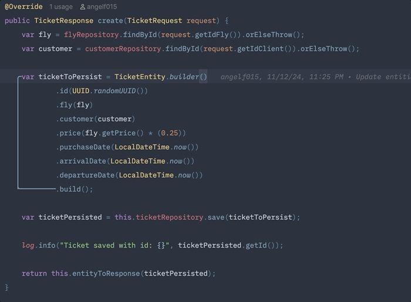
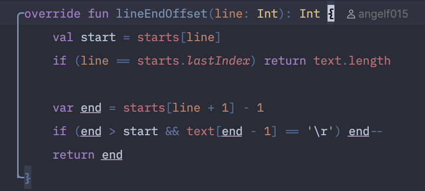
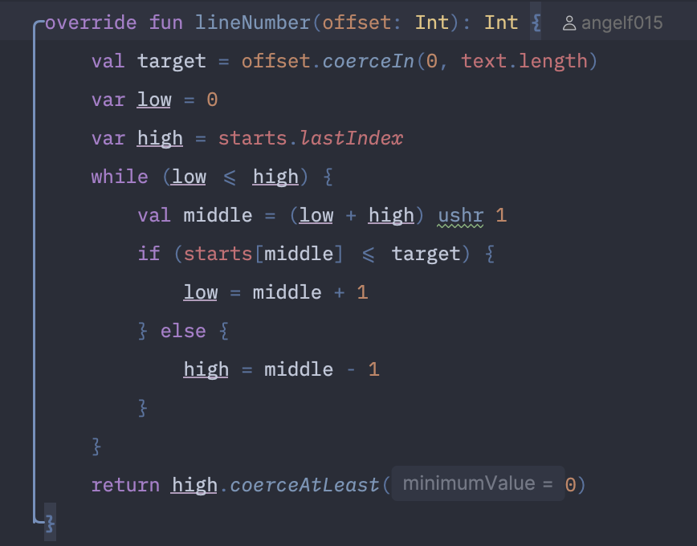
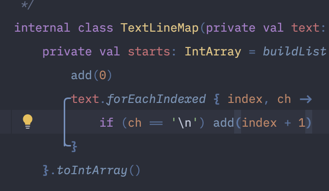

# IndentScope

**English** · [Español](README.es.md)

[](https://github.com/angelf015/IndentScope/actions/workflows/build.yml)
[](https://plugins.jetbrains.com/plugin/35438-indentscope)
[](https://plugins.jetbrains.com/plugin/35438-indentscope)
[](LICENSE)

IntelliJ Platform plugin that highlights the indent guide of the **current scope** with a rounded bracket and hides the
native indent guides while it is active.

The guide starts on the line that opens the scope and ends at its closing bracket, so it works with blocks, multi-line
parentheses and multi-line brackets:

```kotlin
fun main() {
    someFunction(          // guide starts here
        firstArgument,
        secondArgument,
    )                      // guide ends here
}
```

## Demo



The demo moves the caret through the scopes of a `TicketResponse create(...)` method. The rounded guide follows the
innermost enabled scope that contains the caret, and native indent guides stay hidden while the custom guide is active.

## Screenshots

<p align="center">
  
  <br>
  <em>Method scope: the guide runs from the declaration to the closing brace.</em>
</p>

<p align="center">
  
  <br>
  <em>Nested blocks: the selected scope keeps its guide while inner blocks retain their indentation.</em>
</p>

<p align="center">
  
  <br>
  <em>Multi-line lambda: the guide follows a lambda argument inside a <code>buildList</code> call.</em>
</p>

## Features

- Rounded indent guide for the scope containing the caret.
- Optional guides for every enclosing scope, with a configurable limit and progressive attenuation.
- Optional short fade when the current scope changes.
- Supports scopes closed by `}`, `)` and `]`.
- Shows the class-level guide for DTOs and other classes without methods. Guides for scopes that start at column 0 are
  opt-in.
- Works with nested blocks and multi-line calls/conditions.
- Shows top-level unbraced scopes, such as Python `def` and `class` blocks.
- Shows multi-line empty blocks; single-line blocks intentionally draw no vertical guide.
- Ignores brackets inside strings, comments, template literals and raw strings.
- Anchors Allman-style declarations and multi-line signatures to the declaration line instead of the `{` or continuation
  line.
- Keeps the approved look: accent color, rounded corners, no horizontal arms on body lines.
- Hides native indent guides only while the custom guide is active.
- Restores the native indent-guide setting of each editor when disabled, including changes made through the IDE while
  the plugin is active.
- Optional unbraced scopes end at their last body line; they never borrow the closing bracket of an outer block.
- Handles collapsed folds, soft-wrapped lines, multiple carets and HiDPI consistently.
- Reuses the scope analysis and highlighter while the document and scope are unchanged, keeping large files responsive.
- Console, diff and preview editors are supported as opt-in surfaces.
- Settings panel in **Settings → Tools → IndentScope** for behavior and appearance.
- Optional per-project settings with inheritance from the global configuration.
- Theme-aware guide color, also customizable per color scheme.
- Status-bar widget for a quick on/off toggle.
- English and Spanish UI.

## Installation

From the IDE:

1. Open **Settings → Plugins → Marketplace**.
2. Search for **IndentScope** and click **Install**.
3. Restart the IDE when prompted. The restart is required for the plugin to activate.

You can also open the [Marketplace page](https://plugins.jetbrains.com/plugin/35438-indentscope) directly.

From a downloaded ZIP:

1. Download `IndentScope-1.3.0.zip` from the
   [Marketplace versions page](https://plugins.jetbrains.com/plugin/35438-indentscope/versions) or from the
   [GitHub releases page](https://github.com/angelf015/IndentScope/releases) once a release is published.
2. Open **Settings → Plugins**, click the gear icon → **Install Plugin from Disk...**, and select the ZIP.
3. Restart the IDE when prompted. The restart is required for the plugin to activate.

## Toggle the guide

The feature can be disabled globally, for example while presenting code:

| Action | macOS | Windows / Linux |
| --- | --- | --- |
| Toggle IndentScope guide | `Cmd+Option+G` | `Ctrl+Alt+G` |

It is also available in **View → Appearance → IndentScope Guide** and in **Find Action** (`Cmd+Shift+A` /
`Ctrl+Shift+A`).

- The global state is persisted across IDE restarts.
- Toggling applies immediately to every open editor. In a project that inherits the global settings it changes the global
  state; in a project with its own settings it changes only that project.
- New editors respect the effective state of their project.
- While disabled, no scope scanning is performed.
- Shortcuts can be reassigned in **Settings → Keymap**.

The status bar also shows an **IndentScope** widget: click it to toggle the guide, or hide it from the status-bar
settings like any other widget.

## Settings

Open **Settings → Tools → IndentScope** to customize the plugin:

| Setting | Default | Description |
| --- | --- | --- |
| Enable IndentScope guide | On | Global toggle, equivalent to the action and the status-bar widget. |
| Keep native indent guides visible | Off | Draws the custom guide without hiding the IDE's indentation guides. |
| Show the guide only in the active editor | Off | Useful with split editors: only the pane with keyboard focus shows the custom guide. |
| Show the guide for scopes that start at column 0 | Off | Draws guides for scopes whose opener starts at column 0, such as top-level DTOs. |
| Show enclosing scopes | Off | Draws the guides of the parent scopes around the current one. |
| Maximum number of guides | 3 | Number of nested guides, from 1 to 10, when enclosing scopes are enabled. |
| Blocks `{ }` | On | Enables guides for brace-delimited scopes, including indentation-only Python blocks. |
| Parentheses `( )` | On | Enables guides for multi-line parentheses. |
| Brackets `[ ]` | On | Enables guides for multi-line brackets. |
| Stroke width | 1.5 px | Guide thickness, from 1.0 to 4.0 px in 0.5 px steps. |
| Corner radius | 4 px | Rounding of the top and bottom corners, from 0 to 12 px. |
| Use a custom guide color | Off | Overrides the theme color with a color chosen in the settings panel. |
| Animate guide changes | Off | Adds a short 150 ms fade when the current scope changes. |
| Console editors | Off | Draws the guide in console output editors. |
| Diff editors | Off | Draws the guide in diff viewers. |
| Preview editors | Off | Draws the guide in preview editors, such as search results or code-style previews. |

If a scope type is disabled, the guide falls back outward to the nearest enabled enclosing scope instead of
disappearing. At least one scope type must remain enabled. Main editors are always included; auxiliary editor types are
independent and off by default.

### Project settings

Open **Settings → Tools → IndentScope (Project)** to configure a single project:

- **Use global IndentScope settings** is on by default, so the project follows the global panel.
- Turn it off to enable a full project override. The controls stay disabled while the project inherits.
- **Copy global settings** fills the override with the current global values, which is a convenient starting point.
- The override is stored in `.idea/indentScopeProject.xml` and can be committed with the project to share it with the
  team. Files outside a project keep using the global settings.
- In a project with an override, the action and the status-bar widget change only that project. A project that inherits
  toggles the global state.

### Enclosing scopes and animation

Enable **Show enclosing scopes** to draw the chain of parent scopes in addition to the current one. Each parent level is
dimmer than the previous one (100 %, 75 %, 50 %, then 25 %), so the innermost guide remains the focus. **Maximum number
of guides** limits the chain from 1 to 10; the default is 3.

**Animate guide changes** adds a 150 ms fade from the previous guide to the new one. It is off by default, and it settles
immediately when the document or the settings change.

### Visual robustness

- **Collapsed folds:** when the line that opens the scope or its closing line is hidden by a collapsed fold, the guide
  hides. A fold inside the body keeps the outer guide, and expanding the fold restores it immediately.
- **Soft wrap:** the vertical stroke skips continuation rows whose text starts to its left, so it does not paint over
  wrapped content. The first and last rows keep the rounded arms.
- **Multi-line signatures:** when the last parameter and the opening brace share a continuation row, the guide starts
  on the declaration line, so the stroke never crosses the parameter or body text.
- **Multiple carets:** the primary caret defines the current scope. Adding or removing carets refreshes the guide.
- **HiDPI:** stroke width and corner radius are logical pixels. The editor already scales its `Graphics2D`, so applying
  the display scale again would double the size.
- **Column 0:** scopes whose opener has no leading whitespace are opt-in through **Show the guide for scopes that start
  at column 0**. When enabled, the guide is a plain vertical line without arms that runs from just below the opener line
  to just above the closing line, so it never crosses the declaration or its brace. For scopes without a closing
  bracket, such as a top-level Python `def`, it covers the last body line instead.
- **External setting changes:** if **Show indent guides** changes in the IDE while the plugin is active, the native-guide
  policy is reapplied and the latest preference is preserved for when the plugin is disabled.

### Guide color

Without a custom color, the guide follows the active color scheme. You can change it in
**Settings → Editor → Color Scheme → IndentScope**, where it follows the current theme and its light/dark variants.
The resolution order is:

1. Custom color from **Settings → Tools → IndentScope**.
2. **IndentScope guide** color from the active color scheme.
3. The scheme's selected indent-guide color.
4. The scheme's normal indent-guide color.

## Localization

The plugin ships with an English base bundle and a Spanish translation. All user-visible strings follow the IDE
language automatically. The full Spanish documentation is in [README.es.md](README.es.md).

## IdeaVim

The action ID is stable, so it can be mapped directly from `.ideavimrc`:

```vim
" Toggle with <leader>ig (leader defaults to \)
nnoremap <leader>ig <Action>(IndentScope.ToggleGuide)
```

To keep the same macOS shortcut inside Vim:

```vim
nnoremap <D-A-g> <Action>(IndentScope.ToggleGuide)
```

Useful commands while configuring:

```vim
:actionlist IndentScope
:action IndentScope.ToggleGuide
:source ~/.ideavimrc
```

## Requirements

- IntelliJ Platform 2025.2+ (build 252+), including 2025.3 and 2026.x.
- Verified with IntelliJ IDEA 2025.2.6.3, 2025.3.6.1, 2026.1.5, 2026.2.3 and Android Studio 2026.2.1.8.
- The plugin does not depend on a specific language plugin.

## Known limitations

- By default, IndentScope draws one guide at a time: the innermost enabled scope that contains the primary caret. Enable
  **Show enclosing scopes** to draw the parent scopes as well; additional carets still produce only one chain.
- Scopes that start at column 0 are opt-in. Enable **Show the guide for scopes that start at column 0** when top-level
  declarations should show a guide.
- A scope that opens and closes on the same line intentionally draws no vertical guide.
- A project override applies only inside that project. Files opened outside a project, and projects that inherit, use the
  global settings.
- Scope detection uses the language's brace matcher when available. For plain text and languages without a matcher, a
  lexical fallback covers common string and comment syntaxes, but exotic syntaxes may not be recognized.
- Console, diff and preview editors are opt-in and disabled by default.
- The plugin declares `require-restart="true"`, so installing, updating or uninstalling it requires an IDE restart.
- Very large generated files may exceed the scan safety limits and skip a guide.

## Build

Requirements: JDK 21. The Gradle wrapper downloads the rest, and the build declares a JDK 21 toolchain explicitly.

```bash
./gradlew build buildPlugin verifyPluginStructure
```

The `build` task also runs ktlint through the `check` lifecycle. The installable ZIP is generated at:

```
build/distributions/IndentScope-1.3.0.zip
```

Install it from **Settings → Plugins → Install Plugin from Disk**.

IndentScope declares `require-restart="true"`, so the IDE always asks for a restart after installing, updating, or
uninstalling it. Restart when prompted: the guide is active immediately afterwards.

To run a sandbox IDE with the plugin installed:

```bash
./gradlew runIde
```

To check binary compatibility against the supported IDEs:

```bash
./gradlew verifyPlugin
```

Android Studio uses a large installer, so it is opt-in for local verification:

```bash
./gradlew verifyPlugin -PverifyAndroidStudio
```

To generate the coverage report:

```bash
./gradlew koverHtmlReport
./gradlew koverVerify
```

The HTML report is written to `build/reports/kover/html/index.html`. `koverVerify` fails the build if line coverage drops
below 80 %.

## Tests

```bash
./gradlew test
```

The platform tests cover the global toggle, native-guide restoration, persistence, multi-line parentheses and brackets,
unbraced scopes that must not borrow an outer block's closing brace, top-level Python scopes, empty and single-line
blocks, mixed indentation, strings/comments with bracket-like content, backticks, triple quotes, nested comments,
Allman-style declarations, settings persistence and migration, scope-type filtering with outward fallback, the settings
panel, the color settings page, the status-bar widget, folded scopes, folds inside the body, multiple carets, auxiliary
editor filtering, external indent-guide changes, real soft-wrapped editors, controller/service disposal, background
editor registration, concurrent registration, the opt-in column-0 guide with its vertical geometry and a pixel-level
check that it avoids both boundary lines, project settings inheritance and full overrides, enclosing-scope chains with
their fading, and the animated transition. A separate pure test suite covers the scope detector, fold visibility,
editor-kind filtering and soft-wrap path segmentation without starting the IDE, and a performance suite verifies index
reuse and guide resolution in files with 80 000–100 000 lines. A bundle test checks the English and Spanish resources.
The suite currently has **116 tests** (81 platform/integration, 30 pure, 3 performance and 2 bundle tests).

## CI and quality

Every push and pull request builds, tests, lints and packages the plugin on Ubuntu, macOS and Windows. The workflow also
validates the Gradle wrapper and publishes the plugin ZIP and the coverage report as artifacts. Compatibility verification
runs on every push to `main`, on release tags, on a weekly schedule and on demand; the scheduled job also verifies
Android Studio.

```bash
./gradlew ktlintCheck
./gradlew koverHtmlReport
./gradlew verifyPlugin -PverifyAndroidStudio
```

Formatting rules shared by IntelliJ IDEA and ktlint live in `.editorconfig`, and the CI configuration is defined in
`.github/workflows/build.yml`.

## Project structure

```
src/main/kotlin/
├── CurrentScopeIndentGuideFactoryListener.kt  Editor factory listener
├── CurrentScopeIndentGuideController.kt       Per-editor state, lifecycle and guide updates
├── ActiveIndentGuideRenderer.kt               Highlighter renderer and rounded path geometry
├── ScopeAnalysis.kt                           Cached detector and bracket index per document snapshot
├── BracketScanner.kt                          Language-aware bracket scanner and plain-text fallback
├── TextBracketIndex.kt                        One-pass lexical and bracket index for the fallback
├── ScopeDetector.kt                           Pure scope resolution, line map and guide model
├── GuideRobustness.kt                         Fold, editor-kind and soft-wrap visibility helpers
├── IndentScopeService.kt                      Application service: per-editor controllers and refresh
├── IndentScopeSettings.kt                     Persisted settings, normalization and legacy migration
├── IndentScopeConfigurable.kt                 Settings → Tools → IndentScope panel
├── IndentScopeColors.kt                       Color key and theme-aware color resolution
├── IndentScopeColorSettingsPage.kt            Settings → Editor → Color Scheme page
├── IndentScopeStatusBarWidgetFactory.kt       Status-bar widget factory and quick toggle
├── IndentScopeBundle.kt                       Localized message access
└── ToggleIndentScopeGuideAction.kt            Global Show/Hide action

src/main/resources/
├── META-INF/
│   ├── plugin.xml                             Plugin registration
│   ├── pluginIcon.svg                         Plugin icon (light theme)
│   └── pluginIcon_dark.svg                    Plugin icon (dark theme)
└── messages/
    ├── IndentScopeBundle.properties           English strings
    └── IndentScopeBundle_es.properties        Spanish strings

docs/images/
├── demo.gif                                   Animated demo used by both READMEs
├── method-scope.png                           Method-level guide
├── nested-scopes.png                          Nested blocks
└── lambda-scope.png                           Multi-line lambda

src/test/kotlin/com/access/
├── IndentScopeToggleTest.kt                   Platform and integration regression tests
├── ScopeDetectorTest.kt                       Pure detector and visibility tests
├── ScopePerformanceTest.kt                    Index-reuse and large-file tests
└── IndentScopeBundleTest.kt                   English/Spanish resource tests
```

## Support and links

- **Marketplace:** [IndentScope](https://plugins.jetbrains.com/plugin/35438-indentscope)
- **Documentation:** this README and [README.es.md](README.es.md)
- **Bug reports and feature requests:** [GitHub Issues](https://github.com/angelf015/IndentScope/issues)
- **Releases:** [GitHub Releases](https://github.com/angelf015/IndentScope/releases)
- **Changelog:** [CHANGELOG.md](CHANGELOG.md)

Questions are welcome in the issue tracker as well as bug reports. A dedicated forum will be linked here when GitHub
Discussions is enabled.

## Contributing

Issues and pull requests are welcome at
[github.com/angelf015/IndentScope](https://github.com/angelf015/IndentScope).

## License

Released under the [Apache License 2.0](LICENSE).
